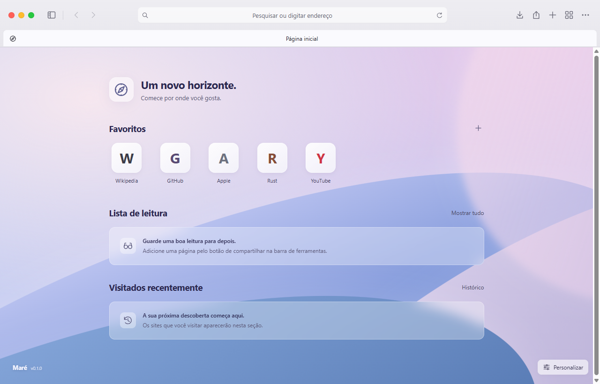

<div align="center">
  
  <p>A desktop browser and an on-demand Rust app platform.</p>
  <p>
    <a href="https://github.com/tavimxlseven/mare-browser/actions/workflows/ci.yml"></a>
    <a href="https://github.com/tavimxlseven/mare-browser/releases"></a>
    <a href="LICENSE"></a>
  </p>
  <p><a href="https://github.com/tavimxlseven/mare-browser/releases/latest">Download</a> · <a href="docs/README.md">Documentation</a> · <a href="CONTRIBUTING.md">Contributing</a> · <a href="https://github.com/tavimxlseven/mare-browser/issues">Issues</a> · <a href="README.pt-BR.md">Português</a></p>
</div>

Maré is a Windows browser built with Rust, Tao and Wry. Web content runs in Microsoft WebView2; the browser interface and app workspace share a local UI. The project is in active development.



## Features

- Tabs, pinned tabs, session restore, bookmarks, history and a reading list.
- Built-in ad and tracker blocking powered by Brave's `adblock-rust`, EasyList and EasyPrivacy, with site exceptions and request counters.
- Reader mode, downloads, find in page, zoom, printing and developer tools.
- Private tabs with separate WebView2 storage and no persisted browsing history.
- Light, dark and system themes, keyboard navigation and reduced-motion support.
- A curated app catalog. Notes, Calculator and the music app run in separate Rust workers, each with its own tab. Switching tabs keeps apps running; closing an app tab stops only its worker.
- A music workspace with public Spotify metadata, local favorites/collections, native local audio and an on-demand Sunnify CLI download component. Optional account import and Discord Rich Presence require registered application IDs.
- An experimental larperCord adapter that hosts the original Zig/SDL client inside an app tab.

## Download

Download the Windows x64 ZIP from [Releases](https://github.com/tavimxlseven/mare-browser/releases/latest), extract it and run `Mare.exe`. Keep the included DLL and license files beside the executable. Windows 10/11 and [WebView2 Runtime](https://developer.microsoft.com/microsoft-edge/webview2/) are required.

## Build

Install stable Rust (1.88 or newer), the MSVC C++ build tools and Windows SDK. A MinGW/GNU toolchain is also supported by the PowerShell scripts.

```powershell
git clone https://github.com/tavimxlseven/mare-browser.git
cd mare-browser
.\scripts\run.ps1
```

```powershell
.\scripts\check.ps1
.\scripts\build.ps1 -Release
```

The portable output is written to `dist\Mare`. When the local D: toolchain is available, scripts use `D:\DevTools` and `D:\DevCache`; otherwise they use Cargo from `PATH`.

For a complete local music/chat build, run `scripts/components.ps1` to prepare the original external components before packaging. CI artifacts contain the Rust host. External components are not redistributed in the public artifact; see [component provenance and terms](docs/COMPONENTS.md). Features documented on `main` may be newer than the latest tagged release.

## Architecture

| Component | Responsibility |
| --- | --- |
| Rust host | Window lifecycle, tab management, storage and trusted IPC |
| WebView2 | Site rendering, cookies, downloads and private profiles |
| Maré Shield | Native network filtering and cosmetic rules |
| App runtime | Allowlisted Rust workers, JSON-lines IPC and on-demand lifecycle |
| Local UI | Browser controls, app catalog and app views |

See [architecture](docs/ARCHITECTURE.md), [native apps](docs/APPS.md), [protection](docs/PROTECTION.md) and the [roadmap](docs/ROADMAP.md).

## Project status

Windows x64 is the supported development target. macOS and Linux have not been validated. The app catalog currently contains bundled apps; third-party package distribution is planned. The [music app](docs/SPOTIFY.md) plays local audio and integrates a headless Sunnify component. Real-account Spotify login and Discord profile activity await application registration and validation. Spicetify continues to customize the installed official client. External components have [separate terms and packaging limits](docs/COMPONENTS.md). No performance comparison with Spotify or other browsers is claimed.

Shield implements a subset of browser privacy features. It does not provide all Brave Shields features, and filter lists can miss ads or break pages. Its controls and data sources are documented in [PROTECTION.md](docs/PROTECTION.md).

## Data

User data is stored in `D:\MareBrowserData` when D: exists, or in `mare-data` beside the executable otherwise. Set `MARE_DATA_DIR` to choose a different location. Profiles and app data are excluded from Git.

## Contributing

Use the issue templates for reproducible bugs and feature proposals. Read [CONTRIBUTING.md](CONTRIBUTING.md) before opening a pull request. Report security issues through the process in [SECURITY.md](SECURITY.md).

## License

Original Maré code is [MIT](LICENSE). Dependencies and bundled filter data retain their own licenses; see [third-party notices](THIRD_PARTY_NOTICES.md). Maré is an independent project and is not affiliated with Apple, Brave or Spotify.
