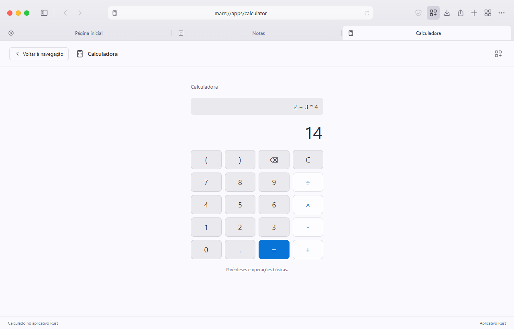

# Apps do Maré

O catálogo inicial contém dois apps locais: **Notas** e **Calculadora**. Seus componentes Rust são distribuídos junto do Maré. Instalar um desses apps registra sua disponibilidade; não baixa outro executável. A interface roda dentro da janela do navegador, e o processamento acontece em um processo Rust separado, criado ao abrir o app.

Spotify e Discord aparecem como propostas futuras, sem botão de instalação. Ainda não há clientes Rust desses serviços implementados nesta versão.

## Ciclo de vida

O esquema mostra o host e os workers de apps; os processos do WebView2 fazem parte da árvore do navegador e não estão representados.

```text
Maré aberto                    Maré.exe
Aba Notas aberta               Maré.exe + Mare.exe --native-app notes
Aba Calculadora também aberta  Maré.exe + worker notes + worker calculator
Selecionar uma aba web         os dois workers continuam abertos
Fechar a aba Notas             Maré.exe + worker calculator
Fechar a aba Calculadora       Maré.exe
```

Cada app aberto corresponde a uma aba e a um worker Rust. Trocar entre uma aba web e um app, ou entre dois apps, conserva os processos e o estado dos outros apps. Selecionar novamente o mesmo app reutiliza o PID existente. O worker termina somente ao fechar sua aba, desinstalar o app ou encerrar o navegador.



As operações já enfileiradas, incluindo o último salvamento, são drenadas antes do fechamento do canal. Um supervisor aguarda até 750 ms em segundo plano e termina o processo se ele não responder. Durante esse intervalo, o PID aparece como encerrando e continua no contador de processos. Fechar o Maré aguarda todos os supervisores para não deixar processos filhos abertos. O caminho de execução do worker entra antes da criação da janela e das WebViews.

O número de processos de apps e os PIDs exibidos vêm dos processos realmente iniciados. A aba em primeiro plano é indicada por `active_id`; `open` e `open_ids` mantêm a ordem das abas de apps abertas. `responses` guarda a última resposta por app, inclusive quando ele está em segundo plano. Essa arquitetura evita iniciar componentes de apps fechados; ainda não há um benchmark que demonstre ganho de CPU ou memória em comparação com clientes de terceiros. As páginas do navegador usam os processos próprios do WebView2, além do processo do Maré.

## Dados locais

```text
MareBrowserData/apps/
  installed.json       apps habilitados pelo usuário
  notes/notes.json     documentos locais do app Notas
  calculator/          diretório reservado ao app Calculadora
```

A pasta fica dentro de `MARE_DATA_DIR`, normalmente em D:. Os arquivos de notas não têm criptografia própria. Desinstalar o app mantém seus documentos locais. O app Notas limita o conjunto de documentos a 96 KB e 200 notas nesta versão; uma operação que excederia o limite é rejeitada antes da gravação. Arquivos inválidos são preservados e não substituídos silenciosamente.

## Protocolo inicial

O worker usa JSON por linha sobre pipes de stdin/stdout, com limite de 128 KiB por mensagem. O host mantém uma fila limitada e não aguarda a resposta na thread da interface.

Solicitação:

```json
{"id":42,"method":"calculate","params":{"expression":"2 + 3 * (4 - 1)"}}
```

Resposta:

```json
{"id":42,"method":"calculate","result":{"expression":"2 + 3 * (4 - 1)","value":11.0,"display":"11"},"error":null}
```

Erros incluem `error.code` e `error.message`; não executam comandos do sistema. A calculadora analisa números, vírgula ou ponto decimal, notação científica, sinais, parênteses e os operadores `+ - * / %`. Não usa eval nem um interpretador de linguagem.

| App | Métodos | Parâmetros |
| --- | --- | --- |
| Todos | `hello` | `{}` |
| Notas | `list` | `{}` |
| Notas | `create` | `{"title":"Nome","body":"Texto"}` |
| Notas | `update` | `{"id":1,"title":"Novo nome","body":"Novo texto"}`; título e texto são opcionais |
| Notas | `delete` | `{"id":1}` |
| Calculadora | `calculate` | `{"expression":"(12 + 3) / 5"}` |

Operações de Notas retornam `{notes:[{id,title,body,updated_at}],selected_id}`. As gravações passam por um arquivo temporário, sincronização e substituição no mesmo diretório. Cada instância recebe um identificador próprio; respostas de um processo encerrado não atualizam outro app aberto depois.

## Modelo de confiança

O catálogo embutido permite executar somente os IDs `notes` e `calculator`. Um manifesto não pode escolher caminhos de executáveis, argumentos de shell ou diretórios arbitrários. Não há instalação de binários remotos nesta versão. Apps nativos executam com as permissões do usuário do Windows; um processo separado não equivale a uma sandbox de segurança.

Uma loja aberta a desenvolvedores externos ainda exige assinatura e verificação de pacotes, versionamento, atualização, permissões, isolamento, revisão de código e uma política de publicação. Esses mecanismos não estão implementados pelo catálogo inicial.

## Verificação dos workers

Depois de compilar o executável, o smoke de workers testa a entrada CLI nativa sem abrir uma janela do navegador:

```powershell
node .\scripts\worker-smoke.mjs --exe=.\target\release\mare-browser.exe
```

O script usa perfis temporários próprios, inicia Notas e Calculadora em paralelo, verifica respostas reais, persistência, operações inválidas e saída por EOF. No ambiente local com `CARGO_TARGET_DIR` em D:, indique o caminho correspondente ao executável. O smoke da integração com a interface fica em `scripts/platform-smoke.mjs` e exige um perfil QA e endpoint CDP loopback.

## Spotify

A [Web API oficial](https://developer.spotify.com/documentation/web-api) fornece integração autorizada com conta, metadados e controle de reprodução. O [Web Playback SDK](https://developer.spotify.com/documentation/web-playback-sdk) é uma biblioteca JavaScript para reprodução na aplicação web; não é um SDK de reprodução nativo em Rust. Qualquer integração precisa considerar autorização, os produtos oficiais disponíveis e a [política do desenvolvedor](https://developer.spotify.com/policy).

Não há credenciais Spotify configuradas no repositório. O catálogo não implementa login, acesso a biblioteca ou streaming Spotify, nem promete contornar as restrições do serviço. Uma próxima etapa possível é um componente Rust para autorização e operações permitidas pela API, validando o mecanismo de reprodução antes de anunciar um cliente compatível.
