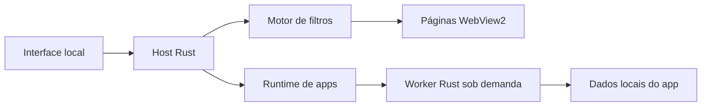

# Arquitetura do Maré

## Componentes

| Componente | Responsabilidade |
| --- | --- |
| `src/main.rs` | Janela Tao, ciclo de eventos, WebViews Wry, navegação, downloads e comandos do host |
| `src/model.rs` | Estado de abas e biblioteca, normalização/validação de URLs e preparação da sessão persistida |
| `src/storage.rs` | Leitura e escrita do estado JSON local |
| `src/protection.rs` | Motor de filtros, interceptação de rede e política por site |
| `src/apps.rs` | Catálogo local e ciclo de vida de processos de apps |
| `src/native_app.rs` | Workers Rust de Notas e Calculadora e protocolo JSON-lines |
| `src/resource_control.rs` | Suspensão e retomada de WebViews em segundo plano |
| `src/reader.js` | Extração textual e apresentação do modo de leitura na página carregada |
| `ui/index.html` | Estrutura da interface local |
| `ui/styles.css` | Temas, barra de ferramentas, abas, sidebar e página inicial |
| `ui/app.js` | Interações da interface, menus, sugestões locais e envio de comandos |
| `scripts/` | Preparação do ambiente Windows, build, execução e verificações |

A implementação validada nesta versão é Windows. Wry usa Microsoft Edge WebView2; Tao fornece janela e eventos nativos. A presença de abstrações multiplataforma não representa suporte verificado a outros sistemas.

## Interface e páginas

A interface é incorporada no executável com `include_str!`: CSS e JavaScript são inseridos no HTML na compilação. Nenhum servidor de desenvolvimento ou runtime Node é necessário para executar o aplicativo.

Uma WebView local exibe a interface. Cada aba que navega para um site ganha sua própria WebView filha nativa na região de conteúdo da janela. A página inicial é renderizada na interface local. Assim, o navegador não depende de iframes, nem das permissões de incorporação de sites em iframes.

Só a WebView da aba web ativa é visível. Menus e diálogos mantêm essa página visível: a interface comunica as áreas dos painéis e o host usa a região da janela nativa e uma superfície transparente para sobrepor os controles. Isso evita mostrar um placeholder de carregamento ao abrir o Shield ou outros menus. Cliques confiáveis na página notificam apenas o fechamento dos painéis, pelo canal restrito de atalhos. Abas inativas mantêm seus documentos; o host solicita `TrySuspend` ao WebView2 depois de ocultá-las e chama `Resume` ao reativá-las. O motor pode recusar a suspensão, por exemplo durante reprodução de mídia. Uma suspensão pendente que conclui depois da reativação é revertida pelo callback.

Ao abrir um app, todas as páginas remotas ficam ocultas e recebem a mesma solicitação de suspensão. A interface do app reutiliza a WebView local. O worker Rust entra por um caminho de execução anterior à criação de Tao/Wry, sem instanciar outro motor web. Apps aparecem como abas próprias. Trocar para uma aba de site ou outro app mantém os workers abertos; fechar uma aba de app encerra somente seu worker. A aba de site retoma o mesmo documento ao voltar ao primeiro plano. Veja o [protocolo de apps](APPS.md).



## Fluxo de eventos

1. Uma ação da interface gera uma mensagem JSON para o host.
2. O host processa a ação no ciclo de eventos Tao e aplica as mudanças ao modelo/WebView.
3. Callbacks de navegação, carregamento, título e downloads retornam eventos ao host.
4. O host publica um snapshot serializado do estado para atualizar a interface. Assinaturas por seção evitam reconstruir abas e biblioteca quando apenas contadores ou métricas mudam.
5. Alterações persistentes são salvas localmente.

As WebViews remotas não recebem o documento da interface nem seu dispatcher de comandos. A ponte de eventos de páginas deve ser tratada como entrada não confiável. O host valida navegação, mensagens e caminhos; esse isolamento é parte central da revisão e dos testes, não uma alegação de auditoria completa.

A interface local tem uma Content Security Policy que bloqueia conexões de rede e carregamento remoto de scripts/imagens. A navegação dessa WebView é restrita ao documento interno. Dados serializados para a interface passam por `serde_json`; strings exibidas pela UI são escapadas.

## Modelo e persistência

`BrowserState` reúne abas, aba ativa, favoritos, histórico, Lista de Leitura, downloads e configurações. IDs monotônicos evitam reutilizar a identidade de itens após restaurar uma sessão. O histórico tem um limite de 1.000 entradas.

O diretório é definido por `MARE_DATA_DIR`. Sem a variável, o Windows usa `%LOCALAPPDATA%\MareBrowser\User Data`, separado por usuário e instalação do sistema. Perfis compartilhados legados exigem importação explícita.

```text
MareBrowserData/
  state.json        estado do Maré em texto JSON
  web-profile/      cookies/cache/armazenamento do motor para navegação comum
  interface/        dados da WebView da interface
  Downloads/        arquivos baixados
```

A escrita de `state.json` usa um arquivo temporário no mesmo diretório, sincronização e rename. O arquivo lido/salvo possui limite de 16 MiB. O carregamento normaliza dados e URLs antes de recriar abas.

A sessão pública exclui abas privadas. Os registros de downloads privados são filtrados antes de salvar, mas arquivos baixados permanecem no diretório de downloads. Abas privadas usam o modo incógnito fornecido por Wry/WebView2. O Maré não implementa criptografia de perfil ou armazenamento de senhas próprio.

## Navegação e downloads

O modelo distingue `mare://start`, endereços web e consultas. Entradas sem esquema que parecem um host são convertidas em HTTPS; outros textos viram pesquisa no mecanismo selecionado. O host restringe a navegação remota a esquemas permitidos.

Requests de nova janela são convertidos em abas. Downloads são direcionados à pasta do aplicativo com nomes saneados e um prefixo para reduzir colisões. O host conserva os estados iniciado/concluído/falhou. Não há gerenciador de pausa/retomada ou barra baseada em bytes nesta versão.

A abertura/revelação de downloads verifica o caminho contra a pasta `Downloads`. Documentos de tipos permitidos podem ser abertos; outros tipos são revelados pelo Explorador, sem execução automática pelo Maré.

## Modo de leitura

O comando de leitura executa um script incorporado na WebView ativa. Ele escolhe o maior elemento article/main disponível, remove controles e elementos não textuais e monta uma apresentação de parágrafos e títulos em Shadow DOM. O conteúdo é inserido como texto, com controles de tamanho e fechamento. É uma extração heurística da página atual, sem download ou cache offline de artigos. A Lista de Leitura continua armazenando apenas links.

## Build e dependências

A versão mínima declarada de Rust é 1.88. A toolchain local desta sessão é `x86_64-pc-windows-gnu` com MinGW. Ela precisa distribuir `WebView2Loader.dll` junto do executável; os scripts fazem essa cópia. A CI usa a toolchain MSVC padrão de `windows-latest`.

O pacote portátil contém o executável com os assets da interface incorporados. WebView2 é um componente externo do sistema. REA é ferramenta de pesquisa separada, fora do runtime e do `Cargo.toml` do Maré.

O código original usa licença MIT. A interface é independente e mantém fluxos familiares de navegadores desktop. O motor de bloqueio mantém MPL-2.0; as listas de filtros mantêm a licença alternativa CC BY-SA 3.0, com atribuição e fontes preservadas.

Os avisos de licenças das dependências, da biblioteca padrão e do WebView2Loader acompanham a distribuição em THIRD_PARTY_NOTICES.md e THIRD_PARTY_LICENSES.txt.

## Process monitor

Open More → Gerenciador de tarefas or press Shift+Esc. Sampling runs only while the panel is open, every two seconds. The host obtains WebView2 process IDs from each environment and adds allowlisted app workers and their descendants. PIDs are deduplicated, and unrelated WebView2 applications are excluded.

Private RAM is the resident private working set. Private memory is committed private memory and can include pages outside RAM. Resident memory includes shared pages, so summing it can double-count shared allocations. CPU is measured from process-time deltas and normalized to the machine's logical processor count; the first sample is unavailable. Missing Windows counters are shown as unavailable.

The panel accounts for this instance without renaming runtime processes or promising a single Windows Task Manager group. WebView2 renderers can serve multiple tabs; memory is not estimated per tab. The WebView2 task manager remains available from the panel.
