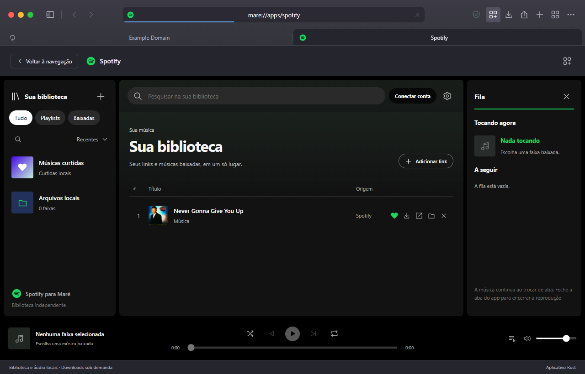

# Música no Maré

O app reúne uma biblioteca de links Spotify, downloads em segundo plano e reprodução de arquivos locais. A interface compartilha a WebView dos controles do navegador; o processamento de biblioteca, IPC e controle de áudio ocorre no worker Rust. A reprodução local usa Rodio/Symphonia e saída WASAPI em uma thread dedicada.



## Disponível

- Títulos e capas reais de links públicos pelo oEmbed do Spotify.
- Busca de faixas Spotify por música/artista, com metadados públicos via XWolf, sem conta nem Client ID. Os resultados mantêm ID Spotify, artista e capa da faixa até a biblioteca e o Rich Presence. A reprodução continua local, após concluir o download.
- Playlist pública Spotify por link, com lista real de faixas e indicação individual de download. Playlists privadas e recursos de conta continuam indisponíveis sem autenticação.
- Playlists locais com criação, renomeação, exclusão e associação de uma faixa a várias playlists. Remover da playlist preserva o download.
- Fila completa, reordenação por arrastar ou botão, remoção individual, anterior/próxima, aleatório sem reposição e repetição da faixa/fila.
- Biblioteca e fila redimensionáveis por divisórias, largura persistente, cantos ajustáveis, lista compacta, painel Tocando agora e temporizador.
- Curtidas e filtro local, sem modificar playlists da conta.
- Biblioteca unificada de links e músicas baixadas, com play na própria faixa, confirmação do download e fila. Downloads repetidos são bloqueados tanto na interface quanto no worker.
- Áudio local com reproduzir/pausar, posição, duração e volume. O worker continua aberto ao alternar abas e encerra ao fechar a aba do app.
- Sunnify CLI 2.6.0 incluído no pacote local completo, sem janela, instalação separada, ajuste de PATH ou configuração pelo usuário. O botão de baixar fornece os parâmetros e a pasta de destino.
- Estado, erros reais e cancelamento de download na interface. Arquivos já concluídos são preservados. Um Job Object encerra os processos auxiliares; o diretório temporário de extração de cada execução é removido depois do encerramento.
- Play em uma faixa ainda não baixada aguarda o downloader terminar e o arquivo ser indexado. O player interpola a posição visual entre amostras nativas; nenhum áudio é reproduzido de um arquivo em gravação. Spicetify continua pertencendo ao cliente oficial.

O Sunnify consulta metadados Spotify e busca o áudio correspondente no YouTube, com seu próprio matcher, yt-dlp, FFmpeg e gravador de tags. Ele **não baixa o fluxo de áudio do Spotify**. O resultado e a disponibilidade dependem da fonte e da rede; falhas são mostradas sem inventar um arquivo ou uma reprodução. Use downloads para conteúdo que você pode baixar. O binário original do Sunnify não foi modificado.

## Aparência e sessão

Em **Ajustes de música**, a navegação separa Aparência, Fundo, Reprodução, Conexões e Downloads. Há temas claro/escuro/sistema, quatro cores de destaque, tamanho de texto e capas, cantos, lista compacta e controle de animações. As divisórias continuam redimensionáveis por mouse ou teclado.

Em **Fundo**, escolha um dos três fundos ou importe PNG/JPEG/WebP de até 12 MB e 40 megapixels. O app reduz a imagem para até 1600 pixels, converte para WebP e salva até 768 KiB no armazenamento local da interface. Nenhuma imagem é enviada a serviços externos. A opção de encaixe e a opacidade dos painéis mantêm o conteúdo legível. O fundo e as preferências acompanham o perfil separado da instalação. A interface usa uma origem HTTPS interceptada e estável (`mare-ui.localhost`), sem abrir um servidor de rede, permitindo Web Storage no WebView2.

A sessão de reprodução fica em `apps/spotify/playback-session.json`: volume, faixa, posição, contexto da playlist, fila, aleatório e repetição. Ao reabrir o app, a faixa aguarda play; o Maré não começa a tocar sozinho. A posição é gravada em intervalos de dez segundos durante a reprodução e também ao pausar/fechar normalmente. Um encerramento forçado pode perder os últimos segundos. Faixas ausentes são descartadas da fila ao restaurar.

O volume responde durante o arraste com eventos agrupados, passos de 1%, roda do mouse e restauração após silenciar. A curva de ganho quadrática oferece ajuste mais fino em níveis baixos; o percentual é uma escala de controle, não uma medida de volume acústico. Esse ajuste não altera o arquivo de áudio.

## Conta Spotify — adiada nesta versão

O botão de login está oculto na 0.3.3, e nenhum Client ID foi embutido. Os detalhes abaixo descrevem o código experimental para uma futura reativação, não uma integração de conta disponível nesta release. Consulte [IDs e configuração](INTEGRATIONS.md).

Há suporte a OAuth Authorization Code com PKCE, callback loopback em `http://127.0.0.1:43821/callback` e permissões somente de leitura: `playlist-read-private`, `playlist-read-collaborative` e `user-library-read`. O login ocorre no site oficial em uma aba privada. A senha nunca entra na interface local do Maré. O callback verifica o estado da sessão e expira após três minutos.

Após autorizar, o worker importa automaticamente playlists e músicas curtidas, com paginação limitada a 500 itens de cada categoria por importação. A interface informa truncamento quando há mais itens. A biblioteca existente é preservada se a gravação excederia os limites. Os tokens ficam apenas na memória do worker; reiniciar o app ou expirar o token exige conectar novamente. Desconectar cancela operações de conta, descarta o token e mantém os links locais já importados.

**Esta instalação ainda não possui Client ID registrado.** O fluxo com uma conta real não foi validado. O mantenedor precisa registrar um aplicativo elegível no Spotify, configurar a URI acima e fornecer `MARE_SPOTIFY_CLIENT_ID` ao compilar. Não existe login simulado nem uso do Client ID de outro cliente. As regras de conta, acesso e quotas do Spotify continuam aplicáveis. Downloads e arquivos locais funcionam independentemente desse login.

## Discord Rich Presence

O worker implementa o protocolo IPC local do Discord, com handshake, atividade do tipo Listening, nome da faixa, artista, timestamps e limpeza ao pausar/parar/sair. Não usa token de usuário nem self-bot. O compartilhamento é opcional nas configurações de música. O Application ID público do Maré é `1568194392156668016`, incluído como padrão. Uma build pode substituí-lo por `MARE_DISCORD_CLIENT_ID`. O nome da atividade depende desse aplicativo registrado; não é o selo oficial do Spotify.

O protocolo foi validado com servidor IPC isolado, faixa WAV silenciosa e o worker real, sem contatar uma conta Discord. O handshake com o Application ID do Maré foi aceito pelo Discord Canary instalado. Essa verificação não publicou uma faixa de teste nem confirmou visualmente a atividade em um perfil real. O Discord desktop precisa estar aberto e o compartilhamento de atividades habilitado. O Discord web incorporado não oferece o servidor IPC local usado pelo Rich Presence; para publicar a atividade, o Discord desktop deve estar aberto.

É possível excluir um download pelo ícone de lixeira da faixa. O arquivo de áudio é removido, o player é interrompido se essa música estava tocando, e os metadados da playlist permanecem. A música pode ser baixada novamente. Exclusões são bloqueadas durante um download ativo.

## Dados e componentes

Os dados ficam em `MARE_DATA_DIR/apps/spotify/`: `library.json`, `downloaded.json`, `completed-downloads.json`, `presence.json`, `audio/` e temporários em `runtime/`. Não são lidos tokens, cookies ou arquivos do Spotify/Spicetify instalado. Os auxiliares de música encerram ao concluir a operação.

A biblioteca de links aceita até 1000 itens, 200 playlists locais e 512 KiB serializados. O índice de arquivos locais aceita até 2000 faixas e 1 MiB. O protocolo de apps é limitado a 2 MiB por mensagem. As atualizações periódicas do player enviam a biblioteca local apenas quando sua revisão muda.

O executável do Sunnify ocupa aproximadamente 158 MB no disco, além dos arquivos temporários durante uma operação; Rust não elimina o tamanho ou o custo desse componente Python/Qt empacotado. Ele sai da memória ao terminar/cancelar. Não há benchmark comparativo de RAM/CPU com o Spotify oficial.

Para preparar os componentes originais em uma build de desenvolvimento:

```powershell
.\scripts\components.ps1
.\scripts\build.ps1 -Release
```

O script baixa versões fixas dos repositórios originais e verifica SHA256. Os componentes não são incluídos no Git. Consulte [COMPONENTS.md](COMPONENTS.md) para origem, versões e licenças.

## Busca Spotify

A busca consulta [XWolf](https://spotify.xwolf.space/api/search), um serviço terceiro, com no máximo 25 resultados por consulta, uma requisição ativa por vez e limites de tempo/resposta. Não consulta o endpoint de tokens, não lê cookies e não conecta a conta do usuário. O serviço recebe o texto digitado na busca; não existe promessa de disponibilidade, quota ilimitada ou suporte oficial do Spotify. Em falhas, o app mostra erro e permite tentar novamente; não troca silenciosamente o resultado por uma gravação de outro catálogo.

IDs e links são normalizados para spotify:track, as imagens ficam restritas às CDNs permitidas e campos têm limites de tamanho. O ID selecionado acompanha o download, a biblioteca e a atividade no Discord. O índice local conserva título/artista/capa canônicos, evitando alternância entre o nome do canal de áudio e o artista Spotify. Entradas YouTube antigas continuam disponíveis; não são convertidas automaticamente em outras músicas por aproximação de título.

Sunnify continua responsável pelos downloads de links Spotify. O áudio não vem do fluxo protegido do Spotify; o matcher e a fonte de áudio mantêm as limitações documentadas acima. yt-dlp/Deno permanecem disponíveis para entradas YouTube já existentes. Login de conta, recomendações pessoais e sincronização de playlists continuam adiados.

## Controle pelo celular

Abra as configurações de música e ative **Controlar pelo celular**. O recurso fica desligado a cada início, exige pareamento e mantém o áudio no PC. Consulte [controle na Wi-Fi](REMOTE-MUSIC.md) para instruções e limites.

## Verificação

```powershell
node scripts/spotify-smoke.mjs --exe=dist/Mare/Mare.exe
node scripts/spotify-smoke.mjs --exe=dist/Mare/Mare.exe --online --audio --catalog
```

`--audio` usa WAV silencioso próprio; exige os componentes multimídia do Windows. `--components` inicia e cancela imediatamente o downloader para verificar seu ciclo de vida, sem baixar áudio externo. `--online` verifica metadados públicos. Essas verificações não equivalem a um download de áudio completo nem a um login de conta real.

Fontes: [Sunnify CLI](https://github.com/sunnypatell/sunnify-spotify-downloader/blob/v2.6.0/docs/CLI.md), [Spotify oEmbed](https://developer.spotify.com/documentation/embeds/reference/oembed), [Spotify PKCE](https://developer.spotify.com/documentation/web-api/tutorials/code-pkce-flow), [Discord RPC](https://docs.discord.com/developers/topics/rpc).
